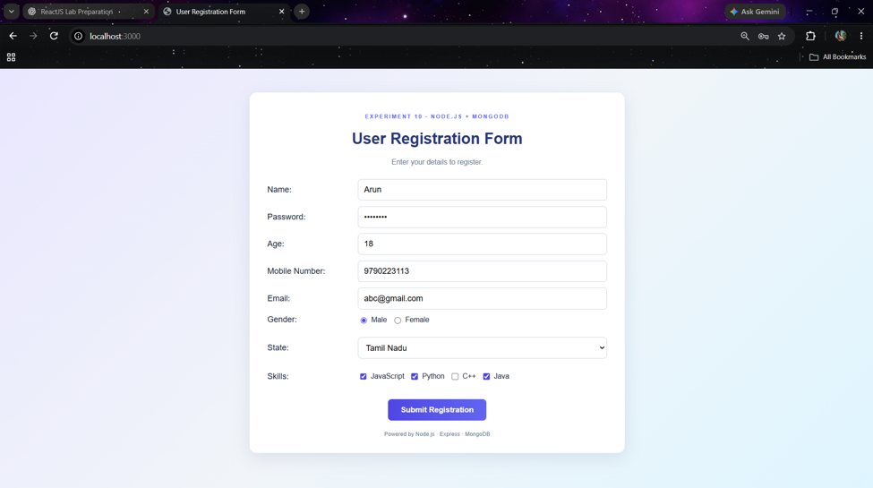
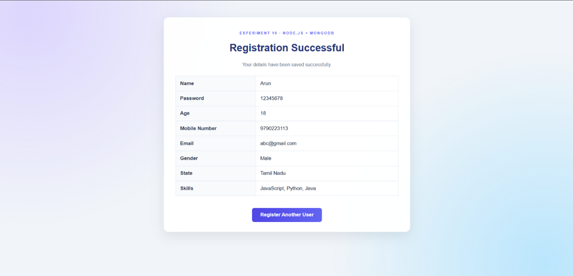
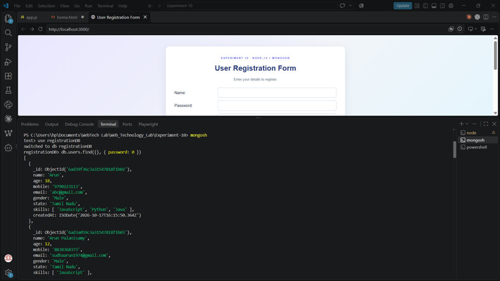

# Experiment 10 — HTML Form Request Handling Using Node.js and MongoDB

A web application that collects user registration details through an HTML form and displays the submitted information after successful registration. The submitted records are stored in MongoDB.

**Technologies:** HTML, CSS, Node.js, Express, MongoDB.

## Screenshots

### Registration Form

### Registration Successful

### MongoDB Record Verification

