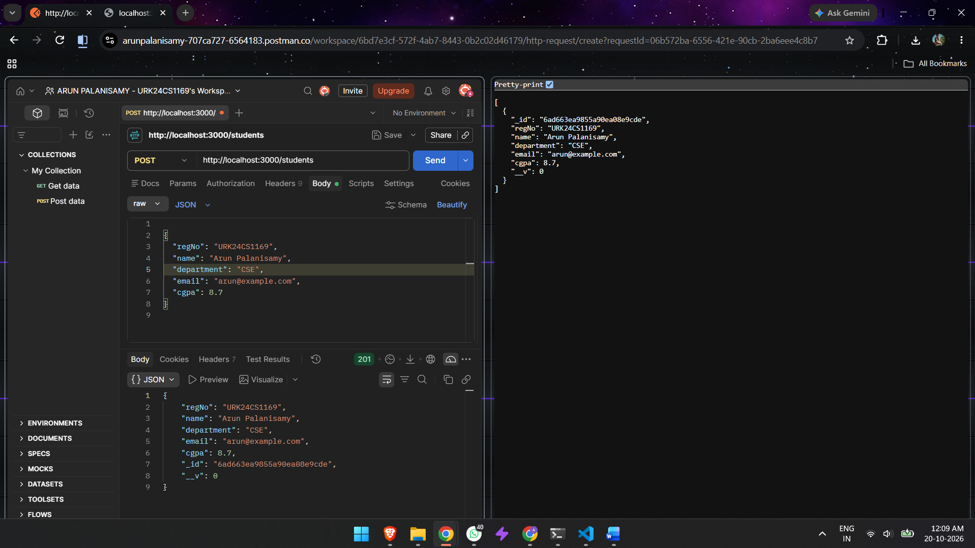
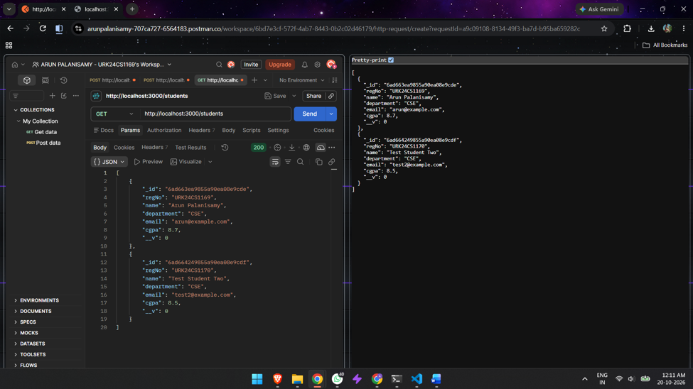
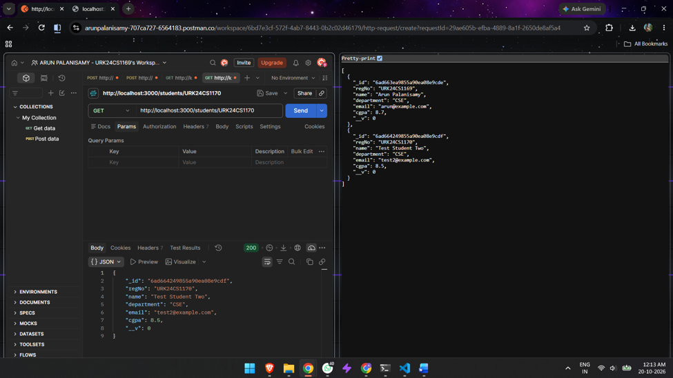
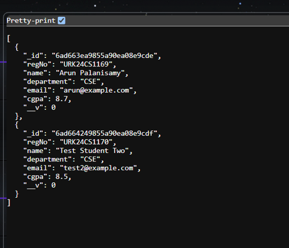
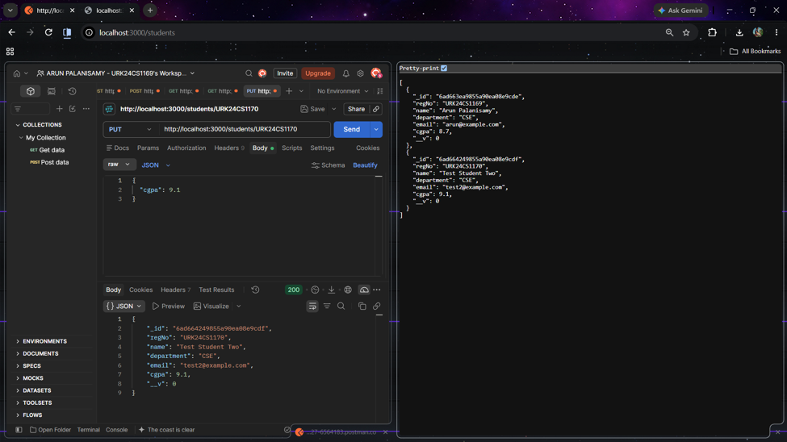
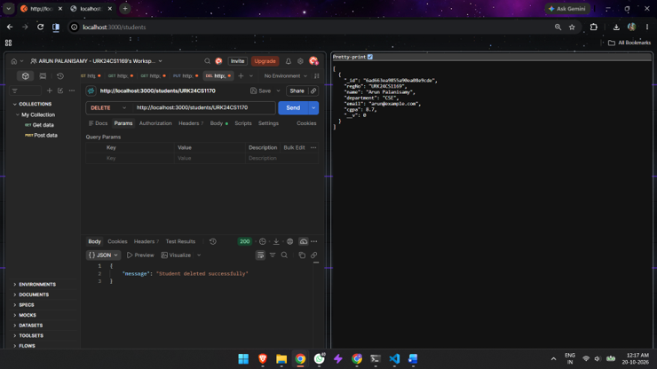
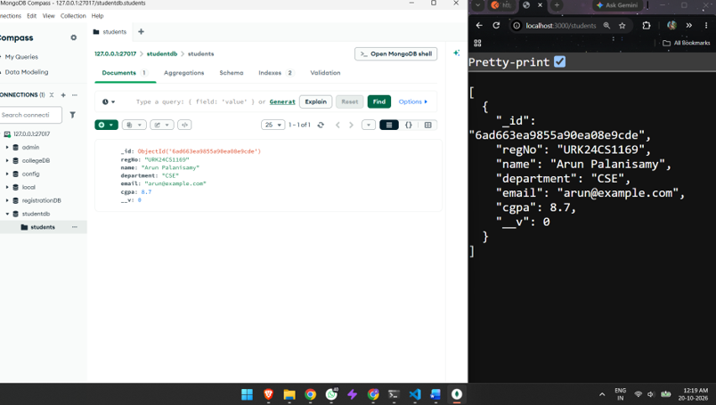

# Experiment 11 — Database Integration in Node.js using MongoDB

Implementation and testing of CRUD operations using Node.js and MongoDB.

## Screenshots

### 1. Create Student — POST

### 2. Retrieve All Students — GET

### 3. Retrieve Student by ID — GET

### 4. Update Student — PUT

### 5. Delete Student — DELETE

### 6. MongoDB — Stored Student Record

### 7. MongoDB — Final Database Records

