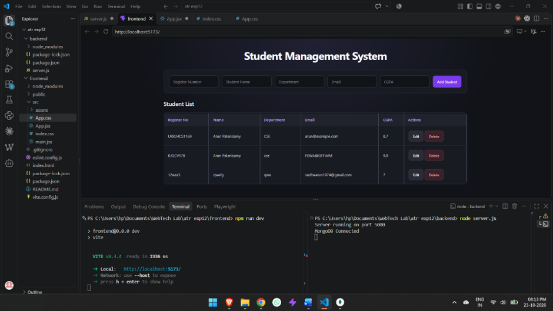
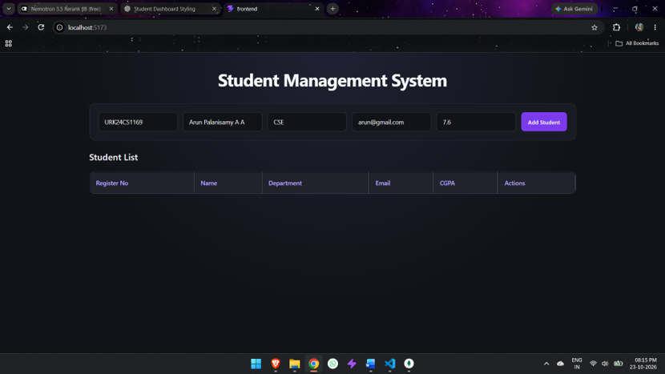
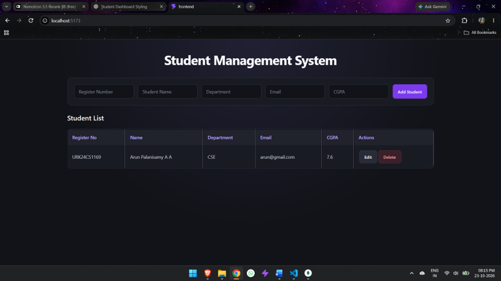
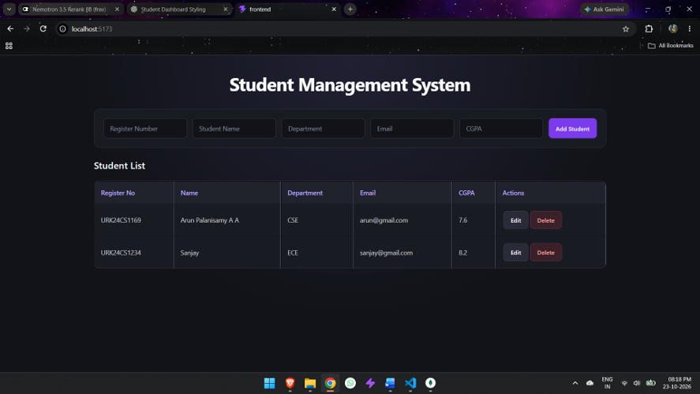
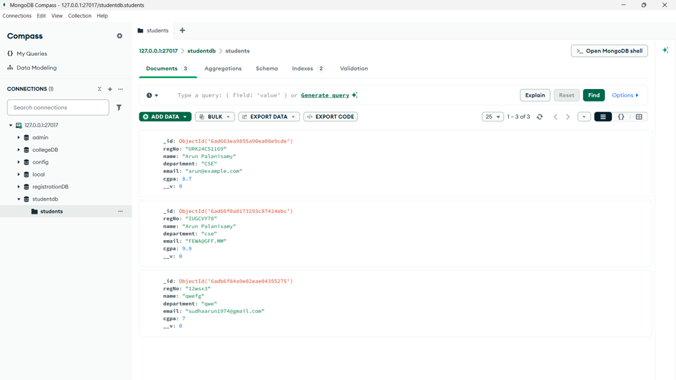
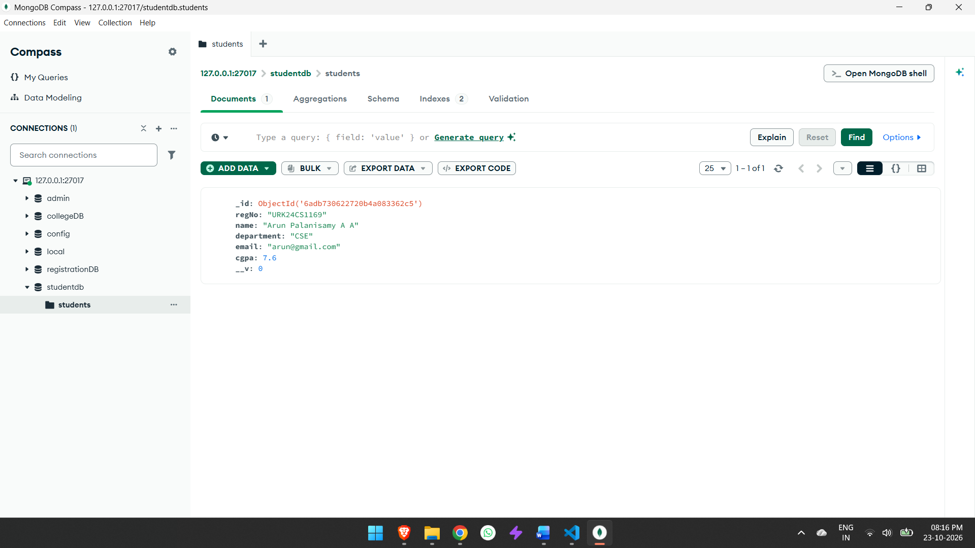
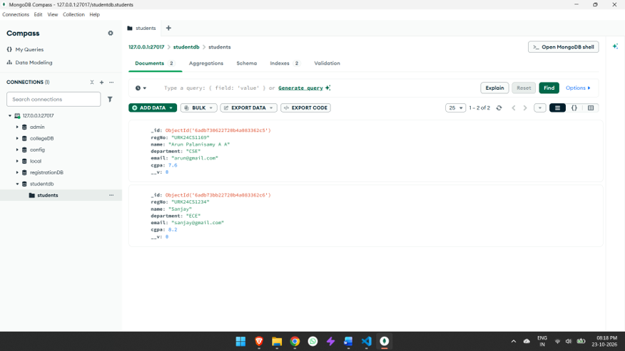

# Experiment 12 — Student Management System

A full-stack student management application built with React, Node.js, Express, and MongoDB. It supports creating, viewing, editing, and deleting student records.

**Technologies:** React, Vite, Axios, Node.js, Express, Mongoose, MongoDB.

## Screenshots

### 1. Student Management System
The application interface running locally.



### 2. Add Student
Student details entered in the form before submission.



### 3. Student Record Created
The newly added student appears in the student list.



### 4. Multiple Student Records
The interface displays multiple student records with Edit and Delete actions.



### 5. MongoDB Compass — Stored Records
Student documents stored in the `studentdb` database, in the `students` collection.







## Run Locally

1. Start MongoDB.
2. In `backend`, install dependencies and start the API:
   ```bash
   npm install
   node server.js
   ```
3. In `frontend`, install dependencies and start Vite:
   ```bash
   npm install
   npm run dev
   ```
4. Open the local URL printed by Vite.

The frontend API URL must match the port used by the backend.
